# 📚 Pustaka Nusantara
### Website Toko Buku Online

Project Ujian Tengah Semester
Mata Kuliah Pemrograman Web 1

[](https://developer.mozilla.org/en-US/docs/Web/HTML)
[](https://developer.mozilla.org/en-US/docs/Web/CSS)
[](https://developer.mozilla.org/en-US/docs/Web/JavaScript)
[](https://github.com)

---

## 👤 Identitas Mahasiswa

| Field | Isi |
|-------|-----|
| **Nama** | Kartika Juliana Sasongko |
| **NIM** | 312310267 |
| **Kelas** | TI.25.1D |
| **Mata Kuliah** | Pemrograman Web 1 |

---

## 🎬 Video Penjelasan

Video ini berisi penjelasan dan demonstrasi fitur website Pustaka Nusantara.

[▶️ Tonton Video Demonstrasi di YouTube](https://youtu.be/Rq8ZAhVG9oo)
---

## 🌐 Demo Online

🔗 **Link Demo:** https://kartika573.github.io/tugas_uts_web1/

---

## 📋 Daftar Fitur per Halaman

### 🔐 `index.html` — Halaman Login
- Form login dengan validasi (email format, field kosong)
- Alert bawaan `alert()` untuk email/password salah sesuai soal
- Modal **Lupa Password** (validasi email terdaftar + pesan simulasi)
- Modal **Daftar Akun** (validasi email unik, password min 6 karakter, konfirmasi)
- Tombol tampil/sembunyi password
- Indikator kekuatan password (Lemah/Cukup/Bagus/Kuat)
- Layout dua kolom: branding kiri + form kanan
- Redirect otomatis ke dashboard jika sudah login
- Toggle tema gelap/terang

### 🏠 `dashboard.html` — Dashboard Utama
- Proteksi halaman (redirect jika belum login)
- Greeting dinamis berdasarkan jam (Pagi/Siang/Sore/Malam)
- Jam digital berjalan (setInterval) + tanggal lengkap Bahasa Indonesia
- 4 kartu navigasi besar dengan ikon, deskripsi, efek hover
- Kartu statistik: total judul, stok, transaksi, pendapatan
- Modal konfirmasi logout
- Toggle tema gelap/terang

### 📚 `stok.html` — Katalog Buku
- Tabel dinamis DOM (createElement/appendChild) dari `dataKatalogBuku`
- Gambar cover buku dari folder `img/`
- Badge status stok (Aman > 200, Menipis 100–200, Kritis < 100) dengan warna
- Pencarian realtime, filter jenis, sort (nama/stok/harga)
- Toggle tampilan Tabel ↔ Grid
- Tombol tambah ke keranjang
- Form tambah buku baru (hanya Admin, simpan ke localStorage)
- Edit stok via modal (hanya Admin)
- Hapus buku (hanya buku tambahan, bukan dari data dosen)
- Counter jumlah data

### 🛒 `checkout.html` — Pemesanan
- Daftar pesanan (tambah dari select, ubah qty, hapus item)
- Validasi jumlah tidak melebihi stok
- Subtotal & total otomatis (format Rupiah)
- Form data pemesan (prefill dari sesi, validasi lengkap)
- Validasi No. HP (pola 08xx, 10–13 digit)
- Validasi kode pos (5 digit)
- Form pembayaran: Transfer Bank, E-Wallet, Kartu Kredit, COD
- Field tambahan menyesuaikan metode pembayaran
- Pilihan ekspedisi JNE / Pos Indonesia dengan ongkir simulasi
- Ringkasan biaya (subtotal + ongkir = total)
- Modal konfirmasi → modal sukses dengan Nomor DO
- Tombol ke tracking dengan Nomor DO otomatis
- Keranjang tersimpan di localStorage

### 📦 `tracking.html` — Tracking Pengiriman
- Input Nomor DO + tombol Cari (juga tekan Enter)
- Skeleton loading sebelum hasil muncul
- Cari di `dataTracking` + transaksi localStorage
- Progress bar bertahap dengan animasi (Diproses → Dikirim → Dalam Perjalanan → Terkirim)
- Timeline vertikal riwayat perjalanan (urut terbaru)
- Detail: nama, ekspedisi, tanggal (format Indonesia), paket, total
- Pesan ramah jika DO tidak ditemukan + saran contoh DO
- Tombol salin Nomor DO
- Chip riwayat pencarian terakhir

### 📊 `laporan.html` — Laporan Pemesanan
- Kartu statistik: total pesanan, buku terjual, pendapatan, buku terlaris
- Grafik batang CSS murni (tanpa library)
- Tabel rekap penjualan per buku
- Tombol cetak (`window.print`) dengan `@media print` rapi
- Empty state jika belum ada transaksi

### 📋 `history.html` — History Transaksi
- Tabel riwayat: data localStorage + contoh dari `dataTracking`
- Pencarian realtime, filter status
- Klik tombol Detail → modal detail transaksi
- Tombol Lacak → ke `tracking.html?do=NOMOR_DO`
- Hapus riwayat individual (dengan konfirmasi)
- Hapus semua riwayat baru (data dosen tetap ada)

---

## 🛠️ Teknologi yang Digunakan

| Teknologi | Keterangan |
|-----------|-----------|
| **HTML5** | Semantik penuh (`header`, `nav`, `main`, `section`, `article`, `aside`, `footer`) |
| **CSS3** | External + Internal + Inline, Flexbox, Grid, `@keyframes`, Media Query |
| **JavaScript (ES6+)** | Vanilla, DOM Manipulation, localStorage, sessionStorage |
| **Google Fonts** | Poppins (body), Playfair Display (judul), Inter (mono) |
| **Ikon** | Emoji & SVG inline |
| **CSS Variables** | Design token lengkap untuk tema terang/gelap |

---

## 📁 Struktur Folder

```
tugas-uts-web1/
├── index.html          → Halaman Login
├── dashboard.html      → Dashboard menu
├── stok.html           → Informasi Stok/Katalog
├── checkout.html       → Pemesanan buku
├── tracking.html       → Informasi Pengiriman
├── laporan.html        → Laporan Pemesanan
├── history.html        → History Transaksi
├── css/
│   └── style.css       → CSS eksternal utama (design tokens, komponen)
├── js/
│   ├── data.js         → Data statis dari dosen (tidak dirombak)
│   └── script.js       → Semua logika JS per modul dengan komentar
├── assets/
│   └── logo.svg        → Logo aplikasi
├── img/                → 5 cover buku
│   ├── kepemimpinan.jpg
│   ├── manajemen_keuangan.jpg
│   ├── mikrobiologi.jpg
│   ├── paud_perkembangan.jpg
│   └── pengantar_komunikasi.jpg
├── screenshots/        → 16 screenshot tiap halaman
└── README.md           → Dokumentasi ini
```

---

## 🔑 Akun Uji Coba

### Akun Default (dari `dataPengguna`)

| Nama | Email | Password | Role |
|------|-------|----------|------|
| Admin Pustaka | admin@pustaka.com | admin123 | **Admin** |
| Budi Santoso | budi@gmail.com | budi123 | User |
| Siti Rahayu | siti@gmail.com | siti123 | User |
| Dewi Lestari | dewi@gmail.com | dewi123 | User |

> **Catatan:** Akun baru yang didaftarkan via modal Daftar akan disimpan di `localStorage` dan bisa digunakan untuk login.

### Nomor DO untuk Uji Tracking

| Nomor DO | Nama | Status |
|----------|------|--------|
| `20230012` | Budi Santoso | ✅ Terkirim |
| `20230013` | Siti Rahayu | 🚚 Dalam Perjalanan |

---

## 📸 Tangkapan Layar

### 01. Halaman Login
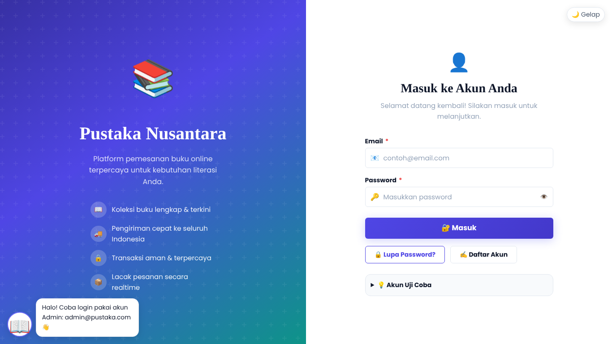

Halaman login dua kolom: branding Pustaka Nusantara dengan buku melayang di latar, dan form login dengan validasi.

### 02. Login Salah (Alert)
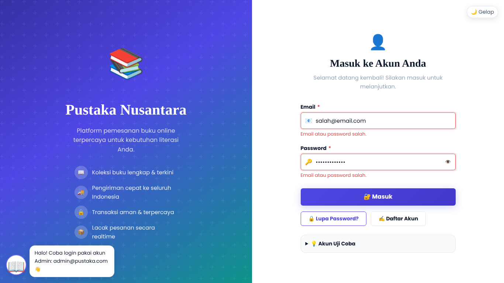

Saat email/password salah muncul `alert()` bawaan browser "email/password yang anda masukkan salah", disertai feedback merah di bawah input.

### 03. Modal Lupa Password
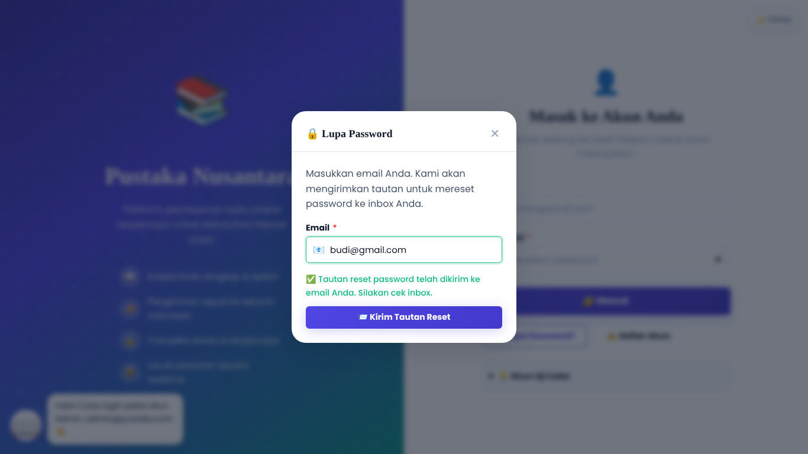

Modal form input email. Email terdaftar tampil pesan sukses simulasi, email tidak terdaftar tampil pesan error.

### 04. Modal Daftar Akun
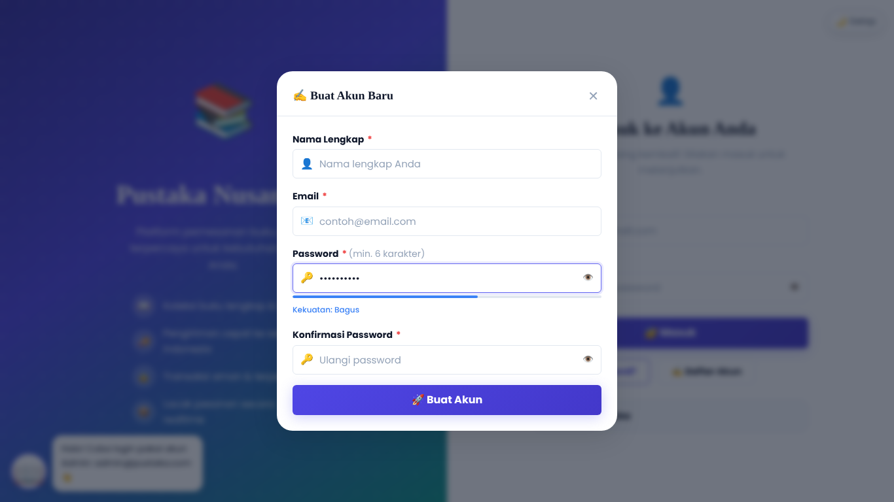

Pendaftaran akun baru dengan validasi: email unik, password min 6 karakter, konfirmasi cocok, dan indikator kekuatan password.

### 05. Dashboard
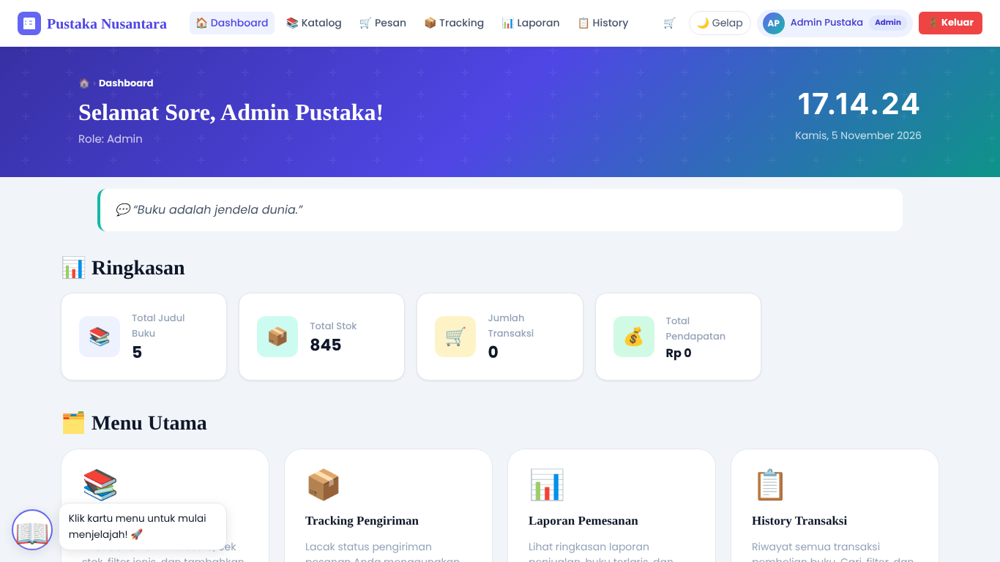

Greeting sesuai jam, jam digital, kutipan hari ini, statistik yang menghitung naik, dan kartu menu utama.

### 06. Katalog Buku
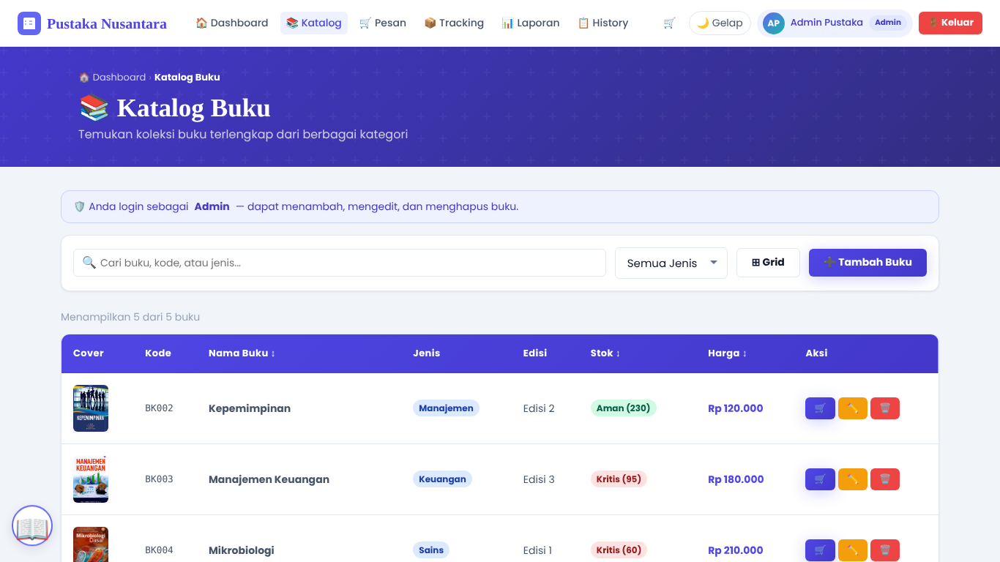

Katalog dengan cover buku, pencarian, filter jenis, badge stok berwarna, dan toggle tampilan tabel/grid.

### 07. Katalog — Tambah Buku (Admin)
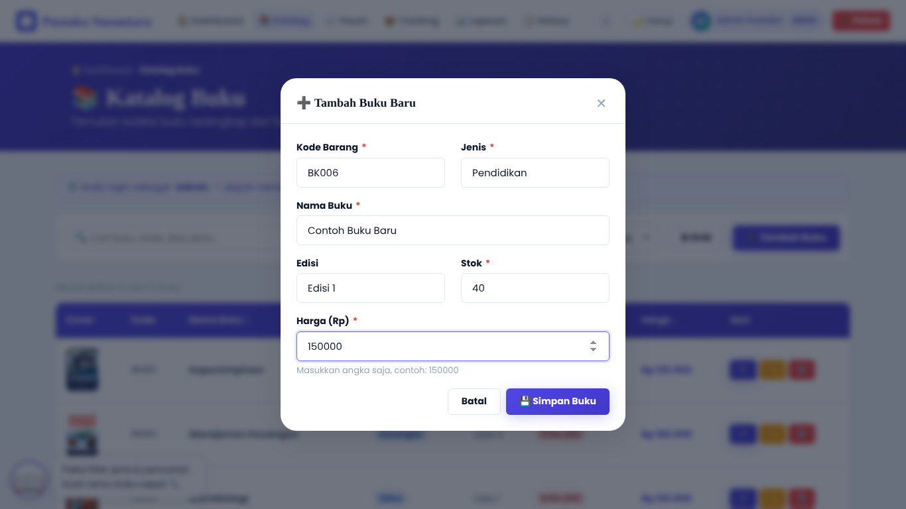

Modal form tambah buku baru dengan validasi kode unik. Hanya tersedia untuk role Admin.

### 08. Katalog — Detail / Tampilan Grid
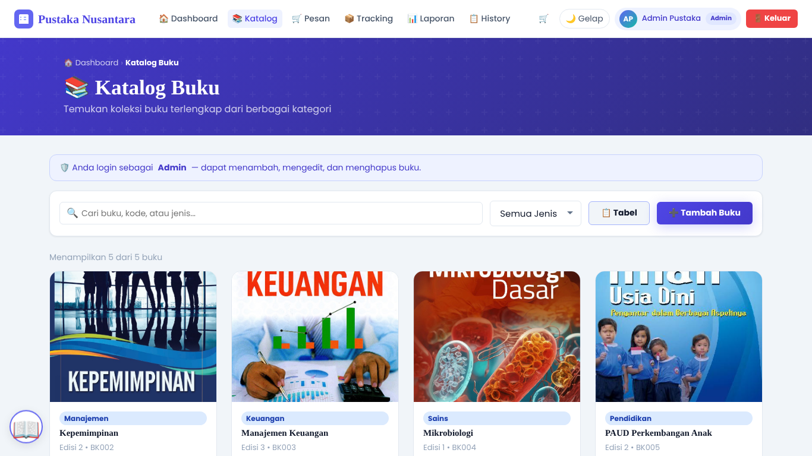

Tampilan grid kartu buku dengan cover, harga, stok, dan tombol tambah ke keranjang.

### 09. Checkout — Form Pemesanan
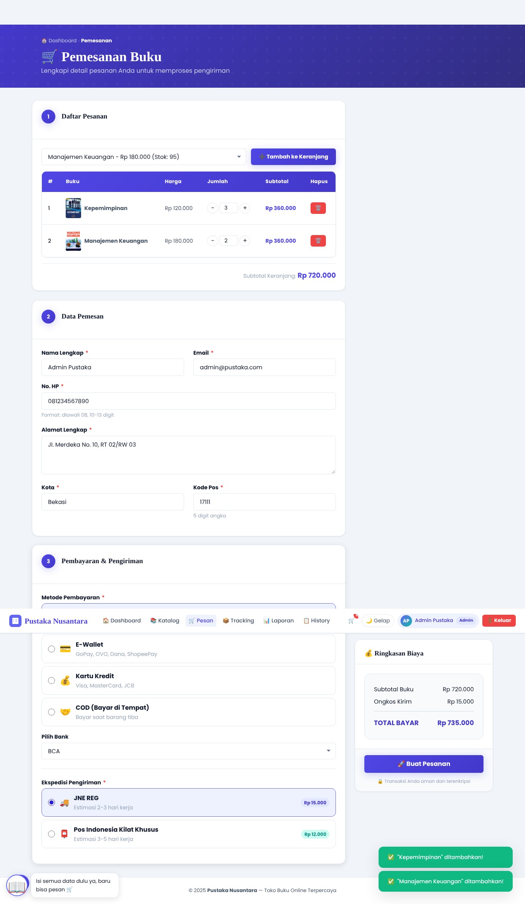

Keranjang pesanan, data pemesan, metode pembayaran/ekspedisi, dan ringkasan biaya di sidebar.

### 10. Checkout Berhasil
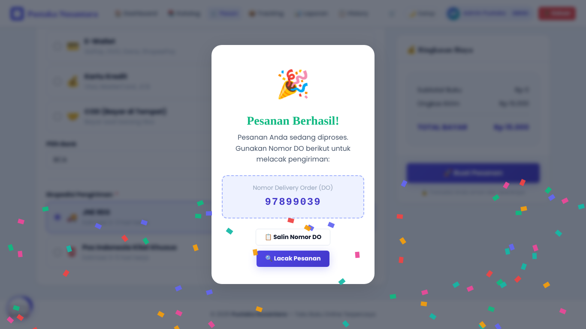

Modal sukses dengan Nomor DO yang bisa disalin atau langsung dilacak, disertai konfeti.

### 11. Hasil Tracking
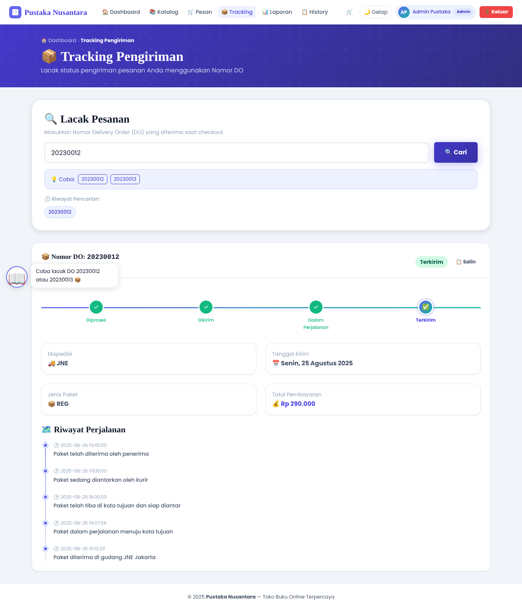

Progress bar bertahap, detail pengiriman, dan timeline perjalanan paket.

### 12. Laporan Penjualan
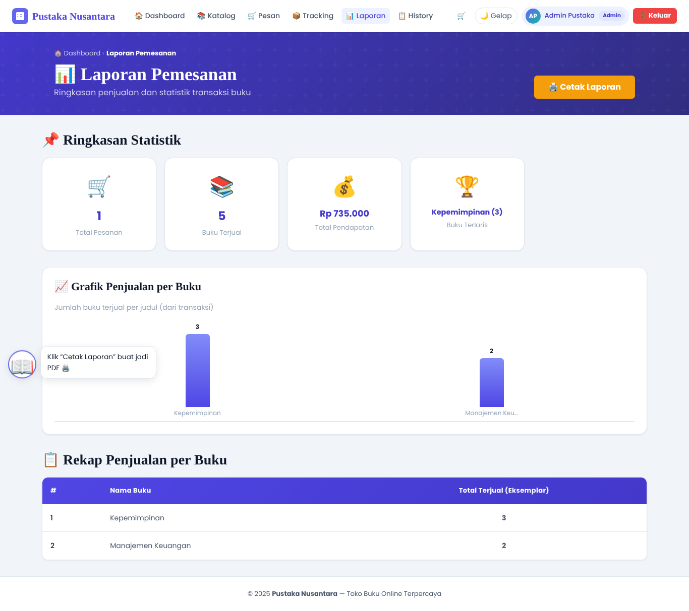

Statistik, grafik batang CSS murni, tabel rekap per buku, dan tombol cetak.

### 13. History Transaksi
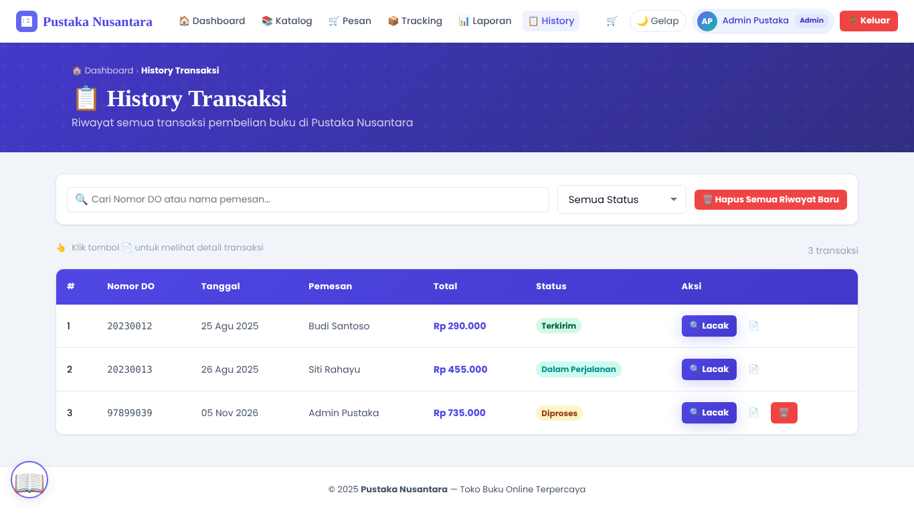

Tabel riwayat transaksi dengan pencarian, filter status, dan aksi detail/lacak.

### 14. Notifikasi / Pesan
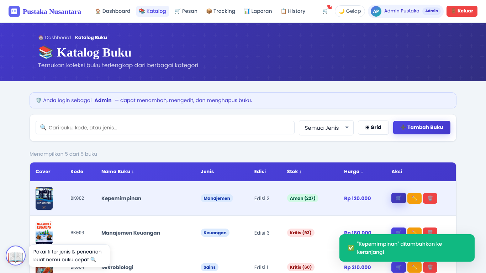

Toast notifikasi atau gelembung tips maskot Si Pusta.

### 15. Mode Gelap
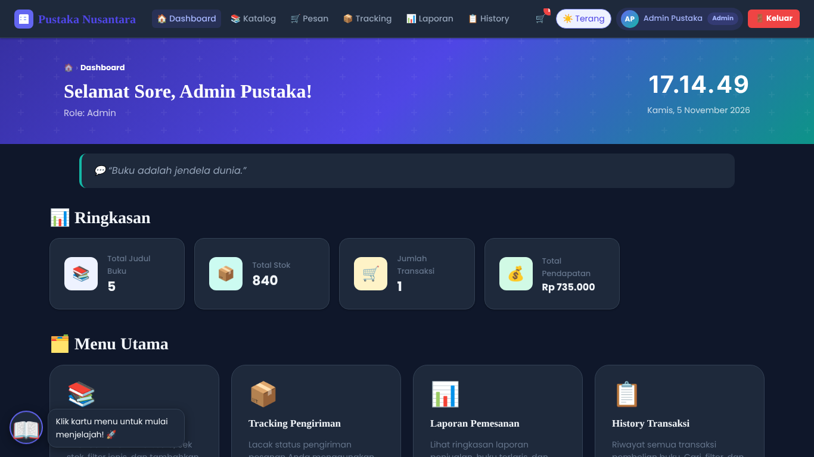

Tampilan mode gelap konsisten di semua halaman, tersimpan di localStorage.

### 16. Tampilan Mobile
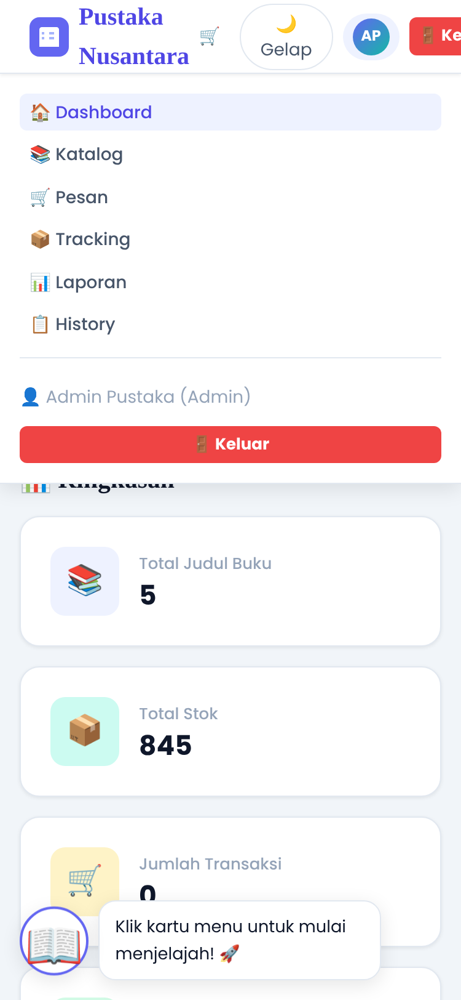

Responsif pada layar 375px dengan hamburger menu dan layout satu kolom.

---

## 🎉 Fitur Tambahan (Animasi & Kejutan)

- 🎊 Konfeti saat checkout sukses
- 📖 Maskot **Si Pusta** (kiri bawah): klik untuk tips per halaman, klik 7 kali untuk kejutan
- 💬 Kutipan hari ini di dashboard (ganti tiap hari)
- 🔢 Angka statistik menghitung naik
- 💧 Efek ripple pada tombol
- ✨ Kartu muncul halus saat di-scroll
- 📚 Buku melayang di latar halaman login
- 🎮 Easter egg: ↑ ↑ ↓ ↓ ← → ← → B A untuk hujan buku
- Semua animasi mati otomatis jika perangkat memakai *reduced motion*

---

## ✅ Pemetaan Kriteria Penilaian

### a) HTML Semantik

| Elemen | Letak | Keterangan |
|--------|-------|-----------|
| `<header>` | Semua halaman | Header halaman (page-header) |
| `<nav>` | Semua halaman | Navbar navigasi utama |
| `<main>` | Semua halaman | Konten utama halaman |
| `<section>` | Semua halaman | Pembagian konten per topik |
| `<article>` | stok.html, tracking.html | Kartu buku, kartu hasil tracking |
| `<aside>` | checkout.html, history.html | Sidebar biaya, info tambahan |
| `<footer>` | Semua halaman | Footer copyright |
| `<table>` + `<thead>/<tbody>` | stok, checkout, laporan, history | Tabel data dengan struktur semantik |
| `<form>` + `<label for>` | index, checkout, stok | Form dengan label terhubung |
| `lang="id"` | Semua halaman | Bahasa Indonesia |
| `alt` pada gambar | stok.html | Alt text deskriptif |
| Heading berurutan (`h1→h2→h3`) | Semua halaman | Hierarki heading yang benar |

### b) CSS — Tiga Jenis

| Jenis | Lokasi | Contoh |
|-------|--------|--------|
| **EXTERNAL** | `css/style.css` | Semua komponen: tombol, kartu, tabel, modal, navbar, animasi |
| **INTERNAL** `<style>` | `index.html` | Layout login dua kolom (`.login-wrapper`, `.login-branding`) |
| **INTERNAL** `<style>` | `dashboard.html` | Hero greeting, kartu navigasi besar |
| **INTERNAL** `<style>` | `stok.html` | Toolbar stok, info banner role |
| **INTERNAL** `<style>` | `checkout.html` | Layout checkout, payment options |
| **INTERNAL** `<style>` | `tracking.html` | Search box tracking, chips riwayat |
| **INTERNAL** `<style>` | `laporan.html` | Grafik batang, kartu laporan, `@media print` |
| **INTERNAL** `<style>` | `history.html` | Toolbar history |
| **INLINE** `style=""` | `dashboard.html` | Warna ikon tiap stat card: `style="background:#eef2ff;"` |
| **INLINE** `style=""` | `checkout.html` | Warna ikon metode bayar: `style="font-size:1.5rem;"` |
| **INLINE** `style=""` | `laporan.html` | Warna tombol cetak: `style="background:#f59e0b;color:white;"` |
| **INLINE** `style=""` | `history.html` | Highlight info box: `style="border-left:4px solid var(--clr-primary-500)..."` |

### c) JavaScript DOM Interaktif

| Fitur | Fungsi JS | Halaman |
|-------|-----------|---------|
| Render tabel dinamis | `renderTableView()` | stok.html |
| Tambah baris DOM | `form-tambah-buku` submit | stok.html |
| Hapus baris | `hapusBuku()` | stok.html |
| Edit stok | `bukaEditStok()` | stok.html |
| Keranjang CRUD | Event delegation | checkout.html |
| Modal buka/tutup | `bukaModal()`, `tutupModal()` | Semua |
| sessionStorage | `simpanSesi()`, `getSession()` | index → dashboard |
| localStorage | `getKeranjang()`, `simpanKeranjang()`, `getTransaksi()` | checkout, tracking, history |
| Query string | `URLSearchParams` | tracking.html, history→tracking |
| Jam digital setInterval | `updateJam()` | dashboard.html |
| Animasi progress | `tracking-progress-line` | tracking.html |

### d) Validasi Form

| Form | Validasi | Feedback |
|------|----------|---------|
| Login | Email format, field kosong, cocok data | Merah di bawah input + `alert()` |
| Lupa Password | Email terdaftar | Pesan sukses/error dalam modal |
| Daftar | Nama wajib, email unik, password min 6, konfirmasi cocok | Per field dengan pesan jelas |
| Tambah Buku | Kode unik, stok ≥ 0, harga > 0, field wajib | Per field dalam modal |
| Checkout Pemesan | Nama, email format, HP 08xx 10-13 digit, alamat, kota, kode pos 5 digit | Per field |
| Checkout Bayar | Ekspedisi & metode wajib dipilih | Toast notifikasi |

### e) Modularitas JS

```
script.js
├── MODUL 1: Utilitas (formatRupiah, parseRupiah, getSession, requireLogin, showToast, bukaModal/tutupModal, dll.)
├── MODUL 2: Tema Gelap/Terang
├── MODUL 3: Navbar (render dinamis)
├── MODUL 4: Modal Logout Global
├── MODUL 5: Toast Container Global
├── MODUL 6: Scroll to Top
├── MODUL 7: initLogin()
├── MODUL 8: initDashboard()
├── MODUL 9: initStok()
├── MODUL 10: initCheckout()
├── MODUL 11: initTracking()
├── MODUL 12: initLaporan()
├── MODUL 13: initHistory()
└── MODUL 14: Inisialisasi Halaman (switch via document.body.dataset.page)
```

---

## 💡 Alur Berpikir & Argumentasi Desain

### Mengapa Semantik HTML?
Pemilihan elemen semantik (`header`, `nav`, `main`, `section`, `article`, `aside`, `footer`) bukan sekadar estetika — ini meningkatkan **aksesibilitas** (screen reader bisa navigasi konten), **SEO**, dan **keterbacaan kode**. `<article>` digunakan untuk kartu buku karena kontennya bisa berdiri sendiri. `<aside>` untuk sidebar checkout karena ia mendukung konten utama.

### Mengapa CSS Dibagi 3 Jenis?
- **External (`style.css`)**: Komponen reusable (tombol, kartu, modal, navbar) dipakai di semua halaman — efisien karena cukup satu perubahan.
- **Internal (`<style>`)**: Gaya unik per halaman (layout login dua kolom, grafik laporan, style print) tidak perlu ada di file global karena tidak dipakai halaman lain.
- **Inline (`style=""`)**: Nilai dekoratif spesifik yang bervariasi per elemen (warna ikon berbeda tiap stat card) — tepat di sini karena terlalu spesifik untuk class.

### Mengapa Data di localStorage?
Soal mensyaratkan front-end saja tanpa server/database. `localStorage` adalah solusi persisten di browser untuk menyimpan:
- Akun baru (terdaftar via modal)
- Buku tambahan
- Keranjang belanja (persist saat pindah halaman)
- Transaksi (bisa dilacak via tracking)
- Tema (dark/light tetap saat refresh)
- Riwayat pencarian DO

### Mengapa Poppins + Playfair Display?
- **Poppins**: Font humanis dengan keterbacaan tinggi di layar, cocok untuk body text dan UI.
- **Playfair Display**: Serif dengan karakter "buku/literasi" yang kuat, dipakai untuk heading/judul memberi kesan toko buku premium.

### Mengapa Palet Indigo + Teal?
- **Indigo** (#6366f1): Warna primer yang profesional dan modern, tidak terlalu dingin seperti biru murni.
- **Teal** (#14b8a6): Aksen yang segar, memberi kesan trust dan literasi.
- **Amber** (#f59e0b): Aksen hangat untuk tombol cetak dan elemen perhatian.

### Mengapa `document.body.dataset.page`?
Satu file JS (`script.js`) mengelola semua halaman. Alih-alih mengecek `window.location.href` yang fragile, `data-page` pada `<body>` adalah cara deklaratif dan semantik untuk menentukan init function mana yang dijalankan. Mudah dibaca, mudah di-debug.

---

## 🚀 Cara Menjalankan

1. **Clone atau Download** project ini
2. **Buka folder** `tugas-uts-web1/`
3. **Buka `index.html`** langsung di browser:
   - Double-click file `index.html`, ATAU
   - Klik kanan → "Open with" → pilih browser, ATAU
   - Gunakan **VS Code Live Server** (klik kanan `index.html` → "Open with Live Server")
4. **Login** menggunakan akun uji coba di atas
5. Tidak perlu server, build tool, atau instalasi apapun!

> ⚠️ **Google Fonts** memerlukan koneksi internet. Jika offline, font akan fallback ke `sans-serif` / `serif` bawaan browser.

---

## 🔧 Catatan Perbaikan `data.js`

Dua perbaikan dilakukan pada `data.js` sesuai instruksi soal:

1. **Path cover buku PAUD**:
   - ❌ Sebelum: `"img/paud_perkembangan.jpeg"`
   - ✅ Sesudah: `"img/paud_perkembangan.jpg"`

2. **Typo waktu di `dataTracking["20230012"]`**:
   - ❌ Sebelum: `"2025-08 25 14:07:56"` (spasi menggantikan tanda hubung)
   - ✅ Sesudah: `"2025-08-25 14:07:56"`

3. **Urutan timestamp** dirapikan agar logis chronologis:
   - `10:12:20` → `14:07:56` → `18:30:00` → dst.

---

*Dibuat dengan ❤️ untuk UTS Pemrograman Web 1*

